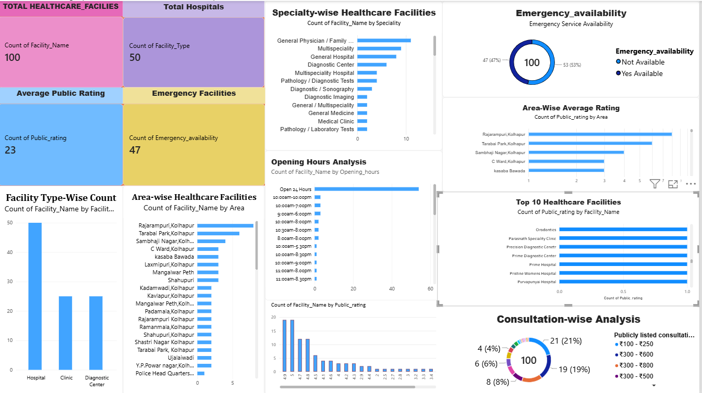
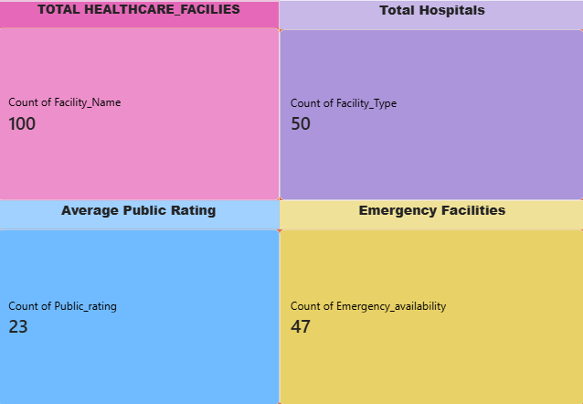
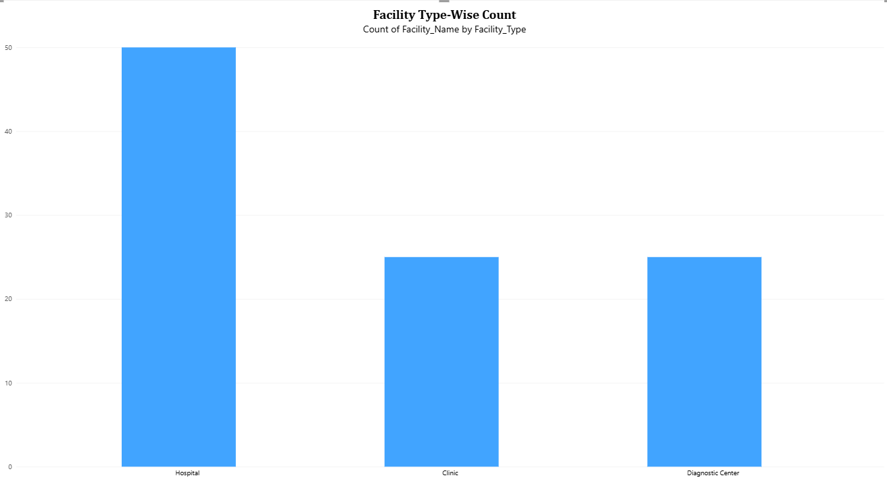

# Local Healthcare Accessibility Analysis

## ZoyaSofts Industry-Ready Internship Project

**Project Type:** Data Analytics and Business Intelligence  
**Project Domain:** Healthcare  
**Project Duration:** 14 Days  
**Prepared by:** Sakshi Patil  
**College:** D. R. Mane Mahavidyalaya, Kagal

---

## 1. Project Overview

The **Local Healthcare Accessibility Analysis** project focuses on analyzing publicly available information about healthcare facilities to understand their distribution, specialties, ratings, consultation ranges, opening hours, and emergency service availability.

The project uses data analytics and business intelligence techniques to organize, clean, analyze, and visualize healthcare facility information.

**Note:** This project uses publicly available healthcare facility information only. It does not contain patient records or private medical information.

## 2. Project Objectives

- Analyze healthcare facilities by facility type.
- Understand healthcare facility distribution across different areas.
- Examine publicly listed ratings and review counts.
- Explore available specialties and opening hours.
- Analyze publicly listed consultation price ranges.
- Identify facilities that publicly list emergency services.
- Present the analysis through charts and a Power BI dashboard.
- Develop data-based observations that may support future healthcare information and management solutions.

## 3. Dataset Information

The dataset contains **100 records and 10 columns**.

| Facility Type | Number of Records |
|---|---:|
| Hospitals | 50 |
| Clinics | 25 |
| Diagnostic Centers | 25 |
| **Total** | **100** |

### Dataset Columns

- `Sr_no`
- `Facility_Type`
- `Facility_Name`
- `Area`
- `Speciality`
- `Opening_hours`
- `Public_rating`
- `Review_count`
- `Publicly_listed_consultation_range`
- `Emergency_availability`

Missing information is represented as `Not Available` where applicable in the dataset.

## 4. Tools and Technologies

- **Excel / CSV:** Dataset storage and inspection
- **PostgreSQL / SQL:** Data querying and analysis
- **Python:** Data analysis
- **Matplotlib:** Data visualization
- **Power BI:** Interactive dashboard and business intelligence

## 5. Project Workflow

1. Business Problem Identification
2. Public Data Collection
3. Data Storage
4. Data Cleaning and Preprocessing
5. SQL Analysis
6. Python Exploratory Data Analysis
7. Data Visualization
8. Power BI Dashboard Development
9. Business Insights and Recommendations
10. Project Documentation

## 6. Analysis and Visualizations

The project explores the following analysis areas:

1. Facility Type-wise Count
2. Area-wise Facility Distribution
3. Facility Name-wise Count or Comparison
4. Facility Rating Analysis
5. Review Count Analysis
6. Opening Hours Analysis
7. Area-wise Average Rating
8. Consultation Range Analysis
9. Emergency Availability Analysis

## 7. Power BI Dashboard

The Power BI dashboard presents healthcare facility information through visualizations and summary indicators.

Dashboard preview:

Additional dashboard screenshots:

## 8. Project Files

- [Dataset - Excel](Local_Healthcare_data.xlsx)
- [Dataset - CSV](Local_healthcare.csv.csv)
- [SQL Queries](Local_healthcare%20query.sql)
- [Python Analysis Code](new%20Healthcare_Analysis.py)
- [Power BI Dashboard File](new%20dashboard..pbix)
- [Internship Documentation](Internship%20Documentation.docx)

## 9. Expected Business Value

The analysis can help organize publicly available healthcare facility information and make it easier to explore facility types, locations, specialties, ratings, and listed services.

The findings may help inform future healthcare information dashboards or facility discovery solutions. Any business opportunity or service gap should be validated with additional research before making operational decisions.

## 10. Limitations

- The analysis is based on the collected dataset and its available fields.
- Public ratings and review counts may change over time.
- Missing or unlisted information cannot be treated as proof that a service does not exist.
- The dataset alone does not establish actual patient demand or prove a healthcare service gap.
- Findings should be interpreted within the limits of the available data.

## 11. Conclusion

This project demonstrates a data analytics workflow for examining publicly available healthcare facility information using SQL, Python, data visualization, and Power BI. It provides a structured way to explore facility distribution and listed service information.

---

**Project:** Local Healthcare Accessibility Analysis  
**Organization:** ZoyaSofts  
**Author:** Sakshi Patil
